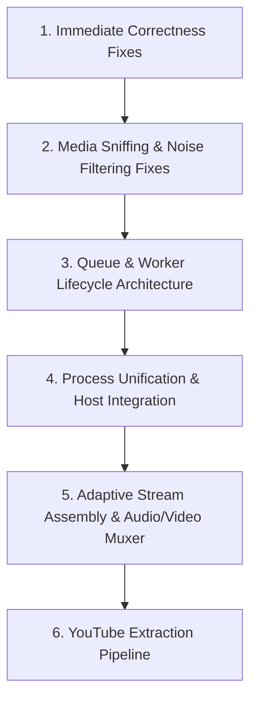

# Hopper Download Manager — Senior Engineer Read-Only Code Audit Report

**Auditor Role:** Senior Software Architect, Rust Systems Engineer, Chromium Extension Specialist, Security & QA Reviewer  
**Inspection Date:** 2026-10-14  
**Audit Scope:** Repository-wide static inspection (`crates/download-core`, `crates/download-host`, `src-tauri`, `ui`, `extension`, `docs`, manifests, tests)  
**Execution Status:** Read-only static analysis. No code was executed, compiled, or modified during the investigation.

---

## A. Executive Summary

Hopper Download Manager is currently at an **early alpha / proof-of-concept stage**, despite documentation (`README.md` and `docs/PROJECT_STATUS.md`) ."

Static code analysis confirms that the two critical problems reported by users are **real, reproducible defects stemming from fundamental architecture gaps and implementation bugs**:

1. **YouTube Media Detection Failure:** The browser extension possesses **no YouTube-specific extraction logic** whatsoever. On YouTube watch pages, the HTML5 `<video>` tag uses MediaSource Extensions (`blob:` URL scheme), which [`extension/src/content.js`](../extension/src/content.js) explicitly ignores. The webRequest listener in [`extension/src/background.js`](../extension/src/background.js) has no minimum file-size threshold for media extensions, so small auxiliary sound effects loaded by YouTube's interface (`failure.mp3`, `open.mp3`, etc.) and Google tracking/font tokens (`f.txt`) are misclassified as primary media streams. Furthermore, the extension contains only an HLS text manifest parser—it cannot download, stitch, or mux adaptive stream chunks.
2. **Downloads Stuck in the Desktop Queue:** Pasting a YouTube watch URL (`https://www.youtube.com/watch?v=...`) sends an HTML webpage URL directly to a naive HTTP file downloader. Furthermore, the Rust engine and Tauri IPC contain multiple compounding concurrency bugs:
   - **Tauri IPC Deadlock / Blocking:** In [`src-tauri/src/main.rs`](../src-tauri/src/main.rs), `start_job` awaits the entire file transfer while holding the global `state.engine` `tokio::sync::Mutex`. This blocks all subsequent Tauri IPC calls (`list_jobs`, `pause_job`, etc.).
   - **Active Cancellation Slot Leak:** In [`crates/download-core/src/engine.rs`](../crates/download-core/src/engine.rs), `active_cancellations` records a job slot before network calls. If the request fails (e.g. YouTube returns HTTP 429/403 or network failure), the function returns early without removing the slot. After 3 failures (the default concurrency limit), `active_count` permanently reaches capacity, and every subsequent job is forced into `JobState::Queued` and never started.
   - **No Queue Dispatcher Loop:** When a worker terminates, `start_next_queued` is never triggered by worker completion, leaving queued jobs stranded.
   - **Frontend ID Contract Mismatch:** Serde serializes `JobId(String)` as a raw JSON string, but [`ui/src/main.tsx`](../ui/src/main.tsx) expects `{ 0: string }` and evaluates `job.id[0] === event.job_id[0]`. In JavaScript, indexing a string returns its first character (`"c89a..."[0]` -> `'c'`). The progress event listener never matches local job IDs.

The two symptoms do **not** share a single mechanical failure point, but they share a common root cause: **the system was designed under the assumption that all web videos are static, single-file direct HTTP downloads**, ignoring modern adaptive streaming architectures (MSE, DASH, signed chunk tokens, and separated video/audio tracks).

---

## B. Documentation vs. Code

| Documented Feature | Actual Implementation | Evidence | Status |
| --- | --- | --- | --- |
| **Dynamic In-Half Range Slicing** | Worker thread splitting exists in [`crates/download-core/src/transfer.rs`](../crates/download-core/src/transfer.rs), but contains a severe data race: multiple workers claim the exact same segment, and splitting truncates ranges currently being streamed by active connections without updating their active HTTP requests. | [`crates/download-core/src/engine.rs:535-562`](../crates/download-core/src/engine.rs#L535-L562) | **Implemented but broken by data races** |
| **HLS (`.m3u8`) & DASH Stream Parser** | Manifest string parser exists for HLS `#EXT-X-STREAM-INF` variants in [`extension/src/protocol.js:261`](../extension/src/protocol.js#L261). However, DASH (`.mpd`) parsing is completely absent (only a string check). Crucially, there is zero segment downloader or TS/M4S assembler; clicking download passes the `.m3u8` playlist URL to the engine as if it were a direct MP4 file. | [`extension/src/background.js:151-160`](../extension/src/background.js#L151-L160), [`extension/src/protocol.js:163`](../extension/src/protocol.js#L163) | **Helper exists, integration unverified & non-functional** |
| **Noise & Telemetry Shield** | Excludes `.png`, `.jpg`, `.woff2`, etc., and octet-streams `< 100 KB`. However, `.txt` is omitted from `IGNORED_EXTENSIONS`, `.mp3` has no minimum size threshold, and missing `Content-Length` headers bypass the telemetry size check. | [`extension/src/protocol.js:14-18, 51-88, 110-116`](../extension/src/protocol.js#L14-L18) | **Implemented but incomplete** |
| **Single Engine Serving Chrome & Tauri** | Documentation claims "One Windows host process serving the Chrome and Tauri clients." In reality, `hopper.exe` and `download-host.exe` are completely disconnected processes that each instantiate an independent `Engine` object pointing to SQLite. | [`src-tauri/src/main.rs:103`](../src-tauri/src/main.rs#L103), [`crates/download-host/src/main.rs:9`](../crates/download-host/src/main.rs#L9) | **Contradictory evidence** |
| **Native Messaging Handoff** | Manifest [`extension/org.open_download_manager.host.json:7`](../extension/org.open_download_manager.host.json#L7) hardcodes extension ID `gaokhlidbpdojkakefeehfpknnnlgkel`. However, [`extension/manifest.json`](../extension/manifest.json) does not declare a `"key"` field, causing Chrome to generate a random extension ID on unpacked load. Chrome refuses native messaging connections with an origin mismatch. | [`extension/manifest.json`](../extension/manifest.json), [`extension/org.open_download_manager.host.json:7`](../extension/org.open_download_manager.host.json#L7) | **Broken configuration** |
| **Link Refresh (`RefreshSource`)** | Engine updates the URL in memory and redacts it in SQLite. However, because `operational_sources` is an in-memory `HashMap`, after an application restart, all operational URLs are lost and jobs cannot resume without manual re-entry. | [`crates/download-core/src/engine.rs:266-272`](../crates/download-core/src/engine.rs#L266-L272), [`crates/download-core/src/store.rs:70`](../crates/download-core/src/store.rs#L70) | **Implemented but incomplete** |
| **Content-Range & Probe Verification** | [`crates/download-core/src/transfer.rs`](../crates/download-core/src/transfer.rs) defines `validate_content_range` and `probe_url`. Neither function is ever called by `engine.rs` during transfers. | [`crates/download-core/src/transfer.rs:5, 42`](../crates/download-core/src/transfer.rs#L5), [`crates/download-core/src/engine.rs:564-568`](../crates/download-core/src/engine.rs#L564-L568) | **Helper exists, integration disconnected (dead code)** |
| **ZIP Central Directory Inspector** | Remote inspection via targeted byte ranges (`preview_remote_zip`) is fully implemented and tested. | [`crates/download-core/src/archive.rs:87-141`](../crates/download-core/src/archive.rs#L87-L141), [`src-tauri/src/main.rs:95`](../src-tauri/src/main.rs#L95) | **Implemented and connected** |
| **Speed Limiter** | Token-bucket limiter is fully implemented with microsecond deficit calculation and unit tests. | [`crates/download-core/src/limiter.rs:17-71`](../crates/download-core/src/limiter.rs#L17-L71) | **Implemented and connected** |
| **Audio/Video Stream Muxing** | Documented as "Phase 3/Milestone 2" in `docs/nxt_tasks.md` and explicitly marked OUT OF SCOPE in `docs/superpowers/specs/2026-10-13-tauri-engine-mvp-design.md`. Zero FFmpeg sidecar or container muxing code exists. | `docs/nxt_tasks.md:49`, `docs/superpowers/specs/2026-10-13-tauri-engine-mvp-design.md:36` | **Missing** |

---

## C. YouTube and Media Detection Findings

### 1. The Detection Pipeline Breakdown

The extension relies on two mechanisms to find media:

```text
[Web Page: YouTube]
   │
   ├── 1. DOM Scanner (content.js: scanDOMMedia)
   │      └── Looks for <video> / <audio> with src="http*".
   │          FAILS: YouTube video elements use src="blob:https://www.youtube.com/..."
   │          Result: 0 media items detected from the DOM.
   │
   └── 2. Network Sniffer (background.js: webRequest.onHeadersReceived)
          ├── Sniffs all HTTP responses for matching MIME / extension.
          ├── YouTube UI loads voice search sound effects (open.mp3, failure.mp3, etc.).
          │   MIME: audio/mpeg, Ext: .mp3 -> Matches MEDIA_EXTENSIONS.
          │   No size check -> RECORDED as downloadable media.
          ├── Google services send f.txt (133 bytes) with attachment disposition.
          │   .txt is not in IGNORED_EXTENSIONS -> RECORDED as downloadable media.
          └── YouTube video streams arrive as chunked MediaSource requests:
              URL: /videoplayback?mime=video%2Fmp4&range=0-1048575&...
              Single video segment without audio, signed with expiring token.
              Result: Even if captured, it is an unplayable single chunk.
```

### 2. Specific Investigation Questions & Answers

1. **Which exact function classifies a resource as downloadable?**  
   [`isMediaUrl`](../extension/src/protocol.js) (line 51) and [`isDownloadableUrl`](../extension/src/protocol.js) (line 90) in `extension/src/protocol.js`, called by `chrome.webRequest.onHeadersReceived` in [`extension/src/background.js:197-198`](../extension/src/background.js#L197-L198).
2. **Why might small sound-effect files be classified as media?**  
   In `protocol.js` line 4, `.mp3` is listed in `MEDIA_EXTENSIONS`. Lines 62–64 evaluate `if (MEDIA_EXTENSIONS.has(ext)) return true;` without checking `contentLength`. Files like `failure.mp3` (6.4 KB) and `open.mp3` (6.0 KB) are audio assets for YouTube's Web Speech / voice search UI and are classified as media. For `f.txt` (133 B), `.txt` is missing from `IGNORED_EXTENSIONS` (lines 14–18), and Google servers serve it with `Content-Disposition: attachment` or chunked `application/octet-stream`, satisfying lines 105–108.
3. **Does the implementation distinguish webpage assets from actual video streams?**  
   No. It relies on coarse extension sets and MIME string prefixes. It cannot differentiate between short UI sounds and complete video tracks, nor does it inspect container headers or duration.
4. **Does it discover genuine video formats, resolutions, codecs, bitrates, and associated audio tracks?**  
   No. On YouTube, genuine stream metadata is embedded in the page's JavaScript context (`ytInitialPlayerResponse.streamingData`). The extension never inspects this data.
5. **Does it merely parse manifests, or can it retrieve and process the actual media segments?**  
   It merely parses `#EXT-X-STREAM-INF` playlist text. It has **no code to fetch, decrypt, or assemble HLS transport stream (`.ts`) or fragmented MP4 (`.m4s`) segments**. If a parsed variant is handed off, the engine attempts to download the `.m3u8` text playlist file directly.
6. **Are YouTube-specific extraction requirements implemented, partially implemented, or absent?**  
   **Completely absent.** There is no player deciphering, `n`-parameter descrambling, player response extraction, or adaptive stream separation.
7. **What happens when a page uses adaptive streaming or signed media URLs?**  
   Adaptive streams (separate 1080p video and audio) cannot be muxed because Hopper lacks an audio/video muxer. For signed URLs (`videoplayback`), the query signature is stripped/redacted when saved to SQLite, making resume impossible.
8. **Does the code incorrectly assume that every downloadable video is a direct HTTP file?**  
   Yes. Both `background.js` and `engine.rs` assume every media link is a standalone file that can be downloaded to disk in a single pass.
9. **Can the extension show quality choices before a real downloadable format has been identified?**  
   Yes. In [`extension/src/content.js:213-216`](../extension/src/content.js#L213-L216), `quality` is fabricated based on `<video>` tag layout dimensions (`videoHeight`p), even if the stream source is a `blob:` or unresolvable.
10. **Evidence:**  
    - `extension/src/protocol.js:2-6, 14-18, 51-88, 105-116`
    - `extension/src/content.js:204-226`
    - `extension/src/background.js:140-185, 188-225`
    - `docs/superpowers/specs/2026-10-13-tauri-engine-mvp-design.md:36`

---

## D. Queue and Download Startup Findings

### 1. The Startup Lifecycle Breakdown

```text
[User pastes "https://www.youtube.com/watch?v=..."]
   │
   ▼
1. ui/src/main.tsx (add)
   └── Extracts filename: parsed.pathname.split("/").pop() -> "watch"
   └── Calls createAndStart(source, "watch")
   │
   ▼
2. ui/src/lib/api.ts (createAndStart)
   ├── Step 1: invoke("create_job", { source, destination: "watch" })
   │     └── src-tauri/src/main.rs: create_job
   │     └── engine.rs: create_job -> store.rs: create_job
   │     └── Job saved in SQLite with state = "queued".
   │     └── Operational URL saved in memory: operational_sources[id] = url.
   │     └── Returns jobId: "8f7e2a9b-..."
   │
   └── Step 2: invoke("start_job", { jobId })
         │
         ▼
3. src-tauri/src/main.rs (start_job)
   └── Acquires state.engine.lock().await (GLOBAL TAURI MUTEX)
   └── Calls Engine::start_job(id)
         │
         ▼
4. crates/download-core/src/engine.rs (start_job_async)
   ├── Checks active_count >= max_concurrency (default: 3)
   │     If active_count >= 3:
   │       Marks state = JobState::Queued in SQLite.
   │       Emits JobState::Queued event.
   │       Returns Ok(()) immediately -> JOB STUCK IN QUEUE FOREVER.
   │
   ├── Inserts cancel_tx into self.active_cancellations (ACTIVE COUNT = 1)
   ├── Sets state = JobState::Active in SQLite.
   ├── Creates destination file: ".8f7e2a9b-...part"
   │
   └── Executes: self.client.get(&source).send().await
         │
         ├── FAILURE PATH (YouTube blocks / 429 Too Many Requests / 403 / Network Error):
         │     Line 327 / 339 returns early with Err(EngineError::InvalidJob).
         │     CRITICAL BUG: self.active_cancellations.remove(&id) IS NEVER CALLED!
         │     The active cancellation slot is PERMANENTLY LEAKED.
         │     After 3 failed attempts, active_count is permanently >= 3.
         │     ALL FUTURE DOWNLOADS IMMEDIATELY BECOME JobState::Queued!
         │
         └── SUCCESS PATH (YouTube returns 200 OK with HTML webpage):
               Engine downloads the HTML webpage (watch.html) into ".watch.part".
               Renames ".watch.part" -> "watch".
               Marks state = JobState::Completed.
               The user receives an HTML file, not a video.
```

### 2. Specific Investigation Questions & Answers

1. **Where is the job initially created?**  
   In [`crates/download-core/src/store.rs:68-106`](../crates/download-core/src/store.rs#L68-L106) (`JobStore::create_job`), invoked via [`crates/download-core/src/engine.rs:191`](../crates/download-core/src/engine.rs#L191) and [`src-tauri/src/main.rs:20-35`](../src-tauri/src/main.rs#L20-L35).
2. **What state is assigned to it?**  
   In SQLite: `"queued"` ([`store.rs:100`](../crates/download-core/src/store.rs#L100)). In React: `"Active"` optimistically ([`ui/src/main.tsx:92`](../ui/src/main.tsx#L92)).
3. **Which function is responsible for starting the download?**  
   `start_job` in [`src-tauri/src/main.rs:38`](../src-tauri/src/main.rs#L38) calling `Engine::start_job` in [`crates/download-core/src/engine.rs:66`](../crates/download-core/src/engine.rs#L66) and `start_job_async` in [`crates/download-core/src/engine.rs:249`](../crates/download-core/src/engine.rs#L249).
4. **What conditions must be satisfied before a worker starts?**  
   `active_count < max_concurrency` ([`engine.rs:253`](../crates/download-core/src/engine.rs#L253)), the job must be present in `operational_sources` ([`engine.rs:270`](../crates/download-core/src/engine.rs#L270)), and `client.get(&source).send().await` must return HTTP 2xx ([`engine.rs:329`](../crates/download-core/src/engine.rs#L329)).
5. **Does the queue scheduler actually dispatch the job?**  
   No. While `start_next_queued` exists in [`engine.rs:136-157`](../crates/download-core/src/engine.rs#L136-L157), it is only called when someone manually invokes pause/cancel/resume. Worker completion does not call `start_next_queued`.
6. **Can a job remain in `New` or `Queued` without an error?**  
   Yes. When `active_count >= max_concurrency`, `start_job_async` writes `JobState::Queued` to SQLite and returns `Ok(())` ([`engine.rs:254-263`](../crates/download-core/src/engine.rs#L254-L263)). The UI receives success, so no error is displayed.
7. **Can a worker fail before the first network request?**  
   Yes. If the application has been restarted, `self.operational_sources` is empty. Line 272 returns `Err("reauthorization required after restart")` before sending any network packet.
8. **Is a YouTube watch-page URL incorrectly sent to a regular file downloader?**  
   Yes. `https://www.youtube.com/watch?v=...` is sent directly as an HTTP GET request.
9. **What happens if the server responds with HTML instead of media data?**  
   The engine accepts it as binary data and writes the HTML into a file named `watch`.
10. **Are redirects, HTTP errors, unsupported formats, and expired signed URLs handled?**  
    Redirects are limited to 10 by reqwest. HTTP errors cause early exit and leak `active_cancellations`. Formats are not validated against content-type. Expired URLs fail without automated refresh.
11. **Are state transitions persisted correctly and reflected in the UI?**  
    Transitions are written to SQLite, but the UI never reflects progress events due to the `job.id[0] === event.job_id[0]` comparison bug.
12. **Can concurrency limits, locks, task failures, or database errors prevent progress?**  
    Yes. Slot leakage in `active_cancellations` permanently blocks the queue after 3 failed downloads. The `state.engine` lock in Tauri blocks the entire UI while a transfer is in progress.
13. **Does the code distinguish a failed transfer from a transfer that has not started?**  
    No. Jobs failing at line 272 leave the SQLite state as `queued`, appearing in the UI as "Waiting in queue".
14. **Most likely root cause:**  
    Pasting a YouTube watch page submits an HTML page to an engine lacking site extractors. When YouTube returns 429/403 or HTML, `active_cancellations` leaks, quickly exhausting `max_concurrent_jobs` (limit: 3), parking all subsequent jobs in `Queued` permanently.

---

## E. Ranked Findings

### [CRIT-01] Tauri Engine Mutex Lock Blocks IPC During Active Downloads

- **Severity:** Critical
- **Confidence:** High
- **Category:** Concurrency / Deadlock
- **Affected File & Function:** [`src-tauri/src/main.rs:38-40`](../src-tauri/src/main.rs#L38-L40) (`start_job`), [`crates/download-core/src/engine.rs:249-412`](../crates/download-core/src/engine.rs#L249-L412) (`start_job_async`)
- **Evidence:** `start_job` awaits `start_job_async`, which executes the entire transfer loop (`download_multisegment` or `stream_response_to_file`) until file completion or error. Because `state.engine.lock().await` is held for the entire duration of `start_job`, no other command (`list_jobs`, `pause_job`, `cancel_job`, `set_speed_limit`) can acquire the lock.
- **User-Visible Consequence:** The desktop application UI freezes or hangs while any download is running.
- **Recommended Correction:** Refactor `start_job` to spawn the download worker as a detached `tokio::spawn` task and return immediately once the job is transitioning to `Active`.

---

### [CRIT-02] Active Cancellation Slot Leak Permanently Blocks the Download Queue

- **Severity:** Critical
- **Confidence:** High
- **Category:** Resource Leak / Queue Stalling
- **Affected File & Function:** [`crates/download-core/src/engine.rs:275-377`](../crates/download-core/src/engine.rs#L275-L377) (`start_job_async`)
- **Evidence:** At line 278, `active_cancellations.insert(id, cancel_tx)` is called. At lines 327 and 339, early returns occur if `client.get(&source).send().await` fails or if `!initial_response.status().is_success()`. The cleanup call at line 376 is skipped.
- **User-Visible Consequence:** After 3 failed requests (HTTP 403, 404, 429, or network drop), `active_cancellations.len()` remains `>= 3`. Line 253 then forces every new download into `JobState::Queued`. Jobs appear in the UI with "⏳ Waiting in queue" and never start.
- **Recommended Correction:** Use an RAII guard (or a `defer`-like pattern) to guarantee `self.active_cancellations.remove(&id)` is executed upon any function exit.

---

### [CRIT-03] Complete Absence of YouTube Video Extraction Pipeline

- **Severity:** Critical
- **Confidence:** High
- **Category:** Architecture / Feature Gap
- **Affected File & Function:** Entire `extension/` and `crates/download-core` codebases
- **Evidence:** `content.js:208` explicitly filters out `blob:` URLs used by YouTube MSE. Neither the extension nor `download-core` contains code to parse `ytInitialPlayerResponse.streamingData`, decipher signature ciphers, transform the `n` rate-limiting parameter, or download separate adaptive audio and video streams and mux them together.
- **User-Visible Consequence:** Opening YouTube shows irrelevant UI sound effects (`failure.mp3`, `open.mp3`) and tracking beacons (`f.txt`). Pasting a YouTube URL downloads an unplayable HTML page or fails immediately with HTTP 429.
- **Recommended Correction:** Implement a dedicated YouTube extraction service (or integrate an external extractor like `yt-dlp` or Innertube client) and add an audio/video muxing stage with FFmpeg.

---

### [HIGH-01] Frontend Job ID Serialization Contract Mismatch

- **Severity:** High
- **Confidence:** High
- **Category:** IPC / Contract Mismatch
- **Affected File & Function:** [`ui/src/lib/api.ts:4-21`](../ui/src/lib/api.ts#L4-L21), [`ui/src/main.tsx:59, 89, 254`](../ui/src/main.tsx#L59)
- **Evidence:** In Rust, `JobId(pub String)` serializes with Serde as a plain JSON string (e.g. `"8f7e2a9b-..."`). In `api.ts`, `Job.id` is typed as `{ 0: string }`. In `main.tsx:59`, the event listener evaluates `job.id[0] === event.job_id[0]`. Indexing a string in JS returns the first character (`"8f7e2a9b-..."[0]` -> `'8'`). For local jobs created via `add()`, `job.id` is `{ 0: id }`, so `job.id[0]` is the full UUID string, whereas `event.job_id[0]` is the single character `'8'`. The condition `"8f7e..." === '8'` is always false.
- **User-Visible Consequence:** Progress bars never move (remain at 0%), speed remains `--`, and state transitions emitted by the backend are ignored by the UI.
- **Recommended Correction:** Update TypeScript types so `id` and `job_id` are typed as `string`, and compare `job.id === event.job_id`.

---

### [HIGH-02] Parallel Worker Race Condition & Data Corruption in Multi-Segment Engine

- **Severity:** High
- **Confidence:** High
- **Category:** Concurrency / Data Integrity
- **Affected File & Function:** [`crates/download-core/src/engine.rs:535-562`](../crates/download-core/src/engine.rs#L535-L562) (`download_multisegment`), [`crates/download-core/src/transfer.rs:125-151`](../crates/download-core/src/transfer.rs#L125-L151) (`try_split_largest_segment`)
- **Evidence:**
  1. Segments have no `in_progress` or `claimed` flag. When 8 workers spawn, all 8 workers iterate `segments` before any chunk arrives (`s.completed == 0`), causing all 8 threads to select Segment 0 and duplicate the download.
  2. `try_split_largest_segment` modifies `seg.end = mid` while an active worker thread is currently streaming up to `old_end`. Both the existing worker and the newly spawned worker write to the same byte range (`mid + 1..old_end`).
- **User-Visible Consequence:** Downloads corrupt target files; network bandwidth is wasted on duplicate stream segments.
- **Recommended Correction:** Add an `in_progress: bool` field to `Segment` and coordinate dynamic splitting via an explicit lock-free range reservation registry.

---

### [HIGH-03] Disconnected Host and Desktop GUI Processes

- **Severity:** High
- **Confidence:** High
- **Category:** Architecture
- **Affected File & Function:** [`src-tauri/src/main.rs:103`](../src-tauri/src/main.rs#L103), [`crates/download-host/src/main.rs:9`](../crates/download-host/src/main.rs#L9)
- **Evidence:** `hopper.exe` and `download-host.exe` each instantiate their own `Engine::new(...)`. They share no process, socket, or IPC channel. Broadcast events emitted in `download-host.exe` are never received by `hopper.exe`. Both processes open `jobs.db` without SQLite WAL mode or busy timeouts, leading to `sqlite3_busy` database locked errors.
- **User-Visible Consequence:** Downloads initiated from the browser extension do not show real-time progress in the desktop application, and concurrent access causes database lock errors.
- **Recommended Correction:** Designate one process as the single engine daemon (or have `download-host.exe` send IPC messages to `hopper.exe` via named pipes / local TCP).

---

### [MED-01] Missing Native Messaging Extension Key in Manifest

- **Severity:** Medium
- **Confidence:** High
- **Category:** Configuration / Extension Security
- **Affected File & Function:** [`extension/manifest.json`](../extension/manifest.json), [`extension/org.open_download_manager.host.json:7`](../extension/org.open_download_manager.host.json#L7)
- **Evidence:** `org.open_download_manager.host.json` specifies `"allowed_origins": ["chrome-extension://gaokhlidbpdojkakefeehfpknnnlgkel/"]`. However, `manifest.json` does not specify a `"key"` property.
- **User-Visible Consequence:** Chrome computes a random ID when loading the unpacked extension. Native messaging fails with `Access to the specified native messaging host is forbidden`, forcing the extension to fall back to standard browser downloads.
- **Recommended Correction:** Generate a persistent extension public key and embed the `"key"` field in `extension/manifest.json`.

---

### [MED-02] Ephemeral Operational Sources Disables Restart Recovery

- **Severity:** Medium
- **Confidence:** High
- **Category:** Persistence & Recovery
- **Affected File & Function:** [`crates/download-core/src/engine.rs:21, 266-272`](../crates/download-core/src/engine.rs#L21), [`crates/download-core/src/store.rs:70`](../crates/download-core/src/store.rs#L70)
- **Evidence:** `operational_sources` is stored only in an in-memory `Mutex<HashMap<JobId, String>>`. `JobStore::create_job` redacts all query parameters before persisting to SQLite. Upon application restart, `operational_sources` is empty. Calling `start_job` fails at line 272 with `EngineError::InvalidJob("reauthorization required after restart")`.
- **User-Visible Consequence:** Interrupted downloads cannot be resumed after closing and reopening the app without manually re-entering the URL.
- **Recommended Correction:** Persist operational URLs securely (e.g. encrypted or in a separate local session cache) rather than discarding them immediately.

---

### [MED-03] Disconnected Primitives (Dead Code in Engine)

- **Severity:** Medium
- **Confidence:** High
- **Category:** Code Quality / Integrity
- **Affected File & Function:** [`crates/download-core/src/transfer.rs:5-33, 42-85`](../crates/download-core/src/transfer.rs#L5-L33) (`validate_content_range`, `probe_url`)
- **Evidence:** Neither `probe_url` nor `validate_content_range` is called by `engine.rs`. In `download_multisegment`, range requests accept any 2xx response and never validate `Content-Range`.
- **User-Visible Consequence:** If a server ignores range headers and responds with HTTP 200, the engine treats the start of the file as segment data, silently corrupting the output.
- **Recommended Correction:** Integrate `probe_url` and `validate_content_range` into `start_job_async` before spawning multi-segment workers.

---

## F. Missing Capabilities

To achieve the intended IDM-like Windows download accelerator experience, the following capabilities must be implemented:

### 1. General Media & Adaptive Streaming

- **HLS Segment Downloader:** Retrieve playlist variant playlists, download `.ts`/`.m4s` chunks concurrently, decrypt AES-128 if present, and stitch segments into a single file.
- **DASH Manifest (`.mpd`) XML Parser & Downloader:** Parse XML adaptation sets, calculate chunk templates (`$Number$`, `$Time$`), and download chunk sequences.
- **Audio/Video Stream Muxer (FFmpeg):** Concurrently download separated adaptive video and audio tracks and merge them into an `.mp4` container using a lightweight FFmpeg sidecar.

### 2. YouTube-Specific Extraction

- **DOM / Context Extraction:** Read `window.ytInitialPlayerResponse` or invoke the internal player endpoints (`/youtubei/v1/player`).
- **Signature Deciphering & `n`-parameter Transform:** Implement the decipher routine from the base player JS (`base.js`) to prevent 403 errors and 50 KB/s bandwidth throttling.
- **MediaSource Extension (MSE) Sniffing:** Intercept chunk streams buffered into HTML5 MSE buffers rather than relying on static `src` attributes.

### 3. Core Engine & Queue Orchestration

- **Asynchronous Task Spawning:** Dispatch transfers into background Tokio tasks so Tauri commands remain non-blocking.
- **Durable Queue Worker Loop:** Automatically trigger `start_next_queued` when any active transfer finishes or fails.
- **Single Process Daemon Architecture:** Use local named pipes or websockets so `hopper.exe` and `download-host.exe` share a single running `Engine` instance.

---

## G. Testing Gaps

Existing tests consist of 27 Rust tests and 9 extension tests that verify isolated unit helpers (token-bucket math, ZIP central directory parsing, string regexes). The following critical areas have **zero automated test coverage**:

1. **Queue Dispatcher on Worker Completion (Priority 1):** No test verifies that completing or failing a job automatically starts the next job in `JobState::Queued`.
2. **Cancellation Slot Cleanup on Network Failure (Priority 1):** No test verifies that an HTTP 429, 403, or connection drop clears `active_cancellations`.
3. **Tauri IPC Command Responsiveness Under Load (Priority 1):** No test verifies that `list_jobs` or `pause_job` can be called while a large download is transferring.
4. **Multi-Segment Worker Claiming & Overlap Prevention (Priority 2):** No test asserts that two workers do not claim the same segment index or write overlapping bytes during in-half splitting.
5. **Content-Range Header Verification (Priority 2):** No test checks that receiving HTTP 200 instead of HTTP 206 during a range request triggers a failure.
6. **False-Positive Media Sniffing Suppression (Priority 2):** No test verifies that sound effects (`.mp3` < 50 KB) or small text attachments (`f.txt`) are excluded from `tabMedia`.
7. **End-to-End Native Messaging Handoff (Priority 3):** No automated integration test covers Chrome extension -> Native Messaging Host -> Rust Engine -> Tauri UI.

---

## H. Recommended Fix Order

A minimal, dependency-aware plan:



1. **Immediate Correctness Fixes:**
   - Fix `JobId` serialization contract in `ui/src/lib/api.ts` and `ui/src/main.tsx` (`job.id === event.job_id`).
   - Wrap `start_job_async` in a cleanup guard to ensure `active_cancellations.remove(&id)` always executes.
   - Decouple `start_job` in `src-tauri/src/main.rs` by spawning the transfer asynchronously and releasing the `state.engine` lock immediately.
   - Add `in_progress` claiming to segments in `download_multisegment` to stop worker race conditions.
2. **Media Sniffing & Noise Filtering Fixes:**
   - Add `.txt` and other text/script extensions to `IGNORED_EXTENSIONS`.
   - Add a minimum file-size threshold (e.g. 500 KB) for audio files in `isMediaUrl` to filter out UI sounds (`failure.mp3`, `open.mp3`).
   - Fix `manifest.json` by adding the fixed public key matching `org.open_download_manager.host.json`.
3. **Queue & Worker Lifecycle Architecture:**
   - Add a worker exit hook that calls `start_next_queued()` whenever a task reaches `Completed` or `Failed`.
   - Persist operational URLs securely to allow resuming interrupted downloads after app restarts.
   - Enable SQLite WAL mode (`PRAGMA journal_mode = WAL;`) and busy timeouts (`PRAGMA busy_timeout = 5000;`).
4. **Adaptive Stream Assembly & Audio/Video Muxer:**
   - Implement HLS segment downloading and TS concatenation in `crates/download-core`.
   - Bundle a lightweight FFmpeg sidecar binary to mux separate 1080p video and audio tracks.
5. **YouTube Extraction Pipeline:**
   - Implement a video metadata resolver capable of querying player APIs and extracting direct stream chunk URLs.

---

## I. First Three Recommended Actions

Based on the evidence discovered during this audit, the first three actions that should be taken are:

1. **Fix the Active Cancellation Leak and Tauri IPC Lock (Root Cause of Queue Stall)**
   - *Evidence:* [`crates/download-core/src/engine.rs:327, 339`](../crates/download-core/src/engine.rs#L327) and [`src-tauri/src/main.rs:38-40`](../src-tauri/src/main.rs#L38-L40).
   - *Action:* Modify `start_job_async` so `active_cancellations` is cleaned up via an RAII scope guard upon any error, and change `src-tauri/src/main.rs` to spawn the download asynchronously so the Tauri engine mutex is released immediately.
2. **Correct the Frontend Job ID Contract Mismatch**
   - *Evidence:* [`ui/src/lib/api.ts:5`](../ui/src/lib/api.ts#L5) and [`ui/src/main.tsx:59`](../ui/src/main.tsx#L59).
   - *Action:* Change `Job.id` in `api.ts` from `{ 0: string }` to `string`, and replace all instances of `job.id[0]` in `main.tsx` with `job.id` so that progress events, action buttons, and list reconciliations match the backend UUIDs.
3. **Filter Out Small Audio Assets and Non-Media Text in Browser Extension**
   - *Evidence:* [`extension/src/protocol.js:14-18, 51-64`](../extension/src/protocol.js#L14-L18).
   - *Action:* Add `.txt` to `IGNORED_EXTENSIONS`, require audio files in `isMediaUrl` to have a verified `contentLength >= 256 * 1024` (256 KB) before classifying them as media, and stop the in-page grabber from capturing UI sound effects.
